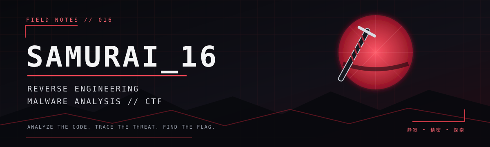

<!-- SAMURAI_16 // profile archive inspired by a technical field-notes blog -->

  

  

    <strong>REVERSE ENGINEER</strong> &nbsp;·&nbsp;
    <strong>MALWARE ANALYST</strong> &nbsp;·&nbsp;
    <strong>CTF PLAYER</strong>
  

  

    
    
    
  

  <i>“Analyze the code. Trace the threat. Find the flag.”</i>

---

<table>
<tr>
<td width="27%" valign="top">

<h3>⚔️ SAMURAI</h3>

<strong>aya-mahmoud134</strong> Cybersecurity · CTF

<h3>Navigation</h3>

- <a href="#about">About</a>
- <a href="#announcement">Announcement</a>
- <a href="#archive">Archive</a>
- <a href="#arsenal">Arsenal</a>
- <a href="#stats">Statistics</a>

<h3>Links</h3>

- <a href="https://github.com/aya-mahmoud134">GitHub</a>
- <a href="https://www.linkedin.com/in/aya-othman-a52707357/">LinkedIn</a>
- <a href="https://github.com/aya-mahmoud134/Samurai_16">Writeup Repository</a>

<h3>Tags</h3>

  
  
  
  
  

<h3>Categories</h3>

- Reverse Engineering
- PWN
- CTF Reports
- Malware Analysis

</td>
<td width="73%" valign="top">

<h2 id="about">About</h2>

I'm a cybersecurity enthusiast focused on understanding software beneath the surface: reversing binaries, investigating malicious behavior, and learning through hands-on CTF challenges.

- 🔬 **Reverse Engineering** — static and dynamic analysis, binary internals, and program logic.
- 🦠 **Malware Analysis** — investigating suspicious files and understanding their behavior.
- 🎯 **CTF Player** — especially interested in **Reverse Engineering** and **PWN**.
- 🛠️ **Research mindset** — documenting techniques, building repeatable workflows, and creating practical tools.

<h2 id="announcement">📌 Announcement</h2>

> Welcome to my Samurai field archive. This is where I collect technical writeups, reversing notes, challenge solutions, and reproducible scripts. New entries are added as I complete and review them.

<h2 id="archive">📚 Field Notes & Writeups</h2>

A collection of challenge analysis and research notes. Choose a category or open an individual case file.

<h3>Reverse Engineering</h3>

| Case file | Focus |
|---|---|
| <a href="https://github.com/aya-mahmoud134/Samurai_16/blob/main/writeups/Dawn-Firmware-Recovery/README.md">Dawn Control — Firmware Recovery</a> | Firmware, CRC, DEFLATE, U-Boot |
| <a href="https://github.com/aya-mahmoud134/Samurai_16/blob/main/writeups/PoshTerm-Service-Code/README.md">PoshTerm — Hidden Service Code</a> | PE, embedded JavaScript, RC4 |
| <a href="https://github.com/aya-mahmoud134/Samurai_16/blob/main/writeups/Carrier-Shadow-Stage-Extraction/README.md">Carrier Shadow — Stage Extraction</a> | ELF, Huffman, xorshift, DEFLATE |
| <a href="https://github.com/aya-mahmoud134/Samurai_16/blob/main/writeups/Operation-Dawn-Annex-06/README.md">Operation Dawn — Annex Entry 06</a> | ELF initialization, rolling XOR |
| <a href="https://github.com/aya-mahmoud134/Samurai_16/blob/main/writeups/Meridian-CAU-Recovery/README.md">Meridian-Class — CAU Recovery</a> | x86-64, bitwise and arithmetic inversion |
| <a href="https://github.com/aya-mahmoud134/Samurai_16/blob/main/writeups/Split-Horizon/README.md">Split Horizon — Vireo Parser Differential</a> | .NET IL, PCAP, parser differential |

<h3>PWN</h3>

| Case file | Focus |
|---|---|
| <a href="https://github.com/aya-mahmoud134/Samurai_16/blob/main/writeups/Forge-House-of-Force/README.md">Forge — House of Force</a> | Heap exploitation |
| <a href="https://github.com/aya-mahmoud134/Samurai_16/blob/main/writeups/Relic-Return-to-CSU/README.md">Relic — Return to CSU</a> | ret2csu, ROP, stack pivot |
| <a href="https://github.com/aya-mahmoud134/Samurai_16/blob/main/writeups/Stepper-Staged-Shellcode/README.md">Stepper — Staged Shellcode</a> | Shellcode, RWX, staged payload |

<h3>CTF Reports</h3>

- <a href="https://github.com/aya-mahmoud134/Samurai_16/blob/main/writeups/CSCTF-Participant-Writeup.md">CSCTF — Participant Writeup</a>

  

<h2 id="arsenal">🛠️ The Arsenal</h2>

  
  
  
  
  
  
  
  

<h2 id="stats">📊 Site Statistics / GitHub Intel</h2>

  
  

</td>
</tr>
</table>

---

  <strong>DISCIPLINE · PATIENCE · PRECISION</strong>
   
  ⚔️ Walk the path. Keep reversing.

